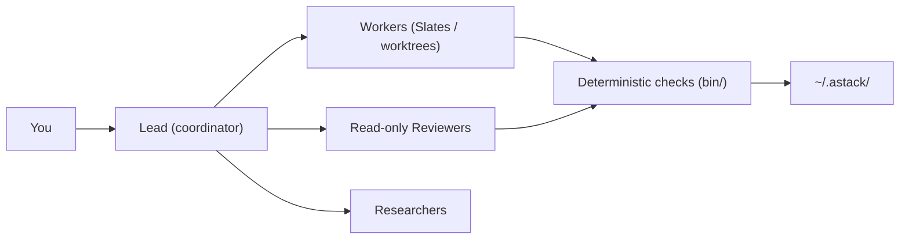

# astack

`astack` is an opinionated toolkit for Claude Code, Codex, Cursor, Antigravity (agy), Pi, Devin, and other Agent Skills hosts. It pairs 95 on-demand skills (only one, go, sits in your context window until needed) with deterministic CLI tools for the parts you shouldn't leave to LLM vibes: merge verification, test-gate tripwires, capture-recapture review stopping math, rate-limit-aware PR and ticket watchers, pinned multi-repo release trains, TLC statechart diagrams, and durable local evidence and lessons. It's my personal toolkit for making sense of and executing on hard problems at scale, whether infrastructural, testing, or product.

I based much of astack off of [pstack](https://github.com/cursor/plugins/tree/main/pstack) and [mattpocock/skills](https://github.com/mattpocock/skills), credit where due and thank you.

---

## Install & setup

**Claude Code**

```
/plugin marketplace add adalundhe/astack
/plugin install astack@astack
```

Restart or run `/reload-plugins`. Update later with `claude plugin marketplace update astack` and `claude plugin update astack@astack`.

**Cursor:** open **Customize**, choose **From GitHub Repository**, and enter `adalundhe/astack`.

**Codex**

```bash
codex plugin marketplace add adalundhe/astack
codex plugin add astack@astack
```

**Antigravity (`agy`)**

```bash
agy plugin install https://github.com/adalundhe/astack
# Or from a local clone:
agy plugin install ~/Projects/astack
```

**Pi, Devin, Cursor CLI (`agent`), and other Agent Skills hosts**

Use the harness-agnostic bundle at `harness/portable/` and install native agents and CLI links:

```bash
harness/portable/bin/astack-tools install-agents --harness all
harness/portable/bin/astack-tools link-bin
```

### Setup

To get started, run `/astack:setup` (`$astack-go setup` in Codex, `/astack-setup` in Cursor), then select the following:

- **Models & approved `reviewer_pool`:** which providers and models handle `lead`, `worker`, `researcher`, and reviews. This list also decides which vendors are allowed to see your code—`astack` never silently substitutes an unapproved model.
- **Autonomy:** `supervised` (default) or `unattended`, with explicit `allow` and `deny` lists.
- **Role timers:** time limits for workers, reviewers, researchers, wind-down, and check-ins (defaults `60 / 30 / 30 / 5 / 5` min).
- **CLI `PATH` links & `~/.astack`:** link `bin/astack-*` into `~/.local/bin` and initialize your local `~/.astack` store.
- **Optional Python automation stack:** stay pure-agentic (`agentic-only`, default) or provision an isolated `uv` venv for `taskex`, `orchestral`, and `werkflow`.

Settings live in `~/.config/astack/settings.json`. If you skip setup, `astack` runs out of the box in `supervised` mode using your current session's model.

---

## How it works

Once setup, run `/astack:go` (`$astack-go` in Codex, `/astack-go` in Cursor) and provide your prompt. Your main session takes on the **Lead** role: the coordinator that shapes the plan, delegates work, checks receipts, and brings you real decisions instead of coding everything itself.



From there, the Lead delegates to three dedicated roles. **Workers** edit code in isolated [Slates](https://github.com/hyper-light/slates) copy-on-write volumes or git worktrees on real timers. **Reviewers** stay strictly read-only—even across different models and CLIs—and save raw proof on disk instead of handing back "LGTM." **Researchers** check docs and live environments before anyone guesses. Your session stays in Go mode across follow-up prompts and compactions until you say `"exit go mode"`.

### Try it

```text
/astack:go Make the export pipeline 10x faster at p99 on the 10 GB sample with byte-identical output,
measured against the current release on the same machine. Merges go to main after lint and tests.
```

From there, the Lead plans a reviewed DAG, dispatches isolated workers on timers, verifies benchmarks and merges, and summarizes what landed (and what didn't). Run `/astack:status` anytime for live timers and commits, or `/astack:whatsup` to catch up after a break.

### Deterministic checks, not just prompts

Prompts are great for judgment and terrible for guarantees. `astack` puts plain Python tools behind the checks that matter: catching skipped tests, verifying real git merges, pacing forge API limits, refusing floating refs like `main` or `latest` on releases, and requiring real evidence files on disk before posting a PR reply.

When a recurring job shouldn't be steered by an agent at all, you can turn a prompt into a saved, manageable Python automation with [taskex](https://github.com/adalundhe/taskex), [orchestral](https://github.com/adalundhe/orchestral), or [werkflow](https://github.com/adalundhe/werkflow) (+ `werkflow-modules`).

### Memory that outlives the chat

`astack` keeps a user-private store outside your git repos:

```text
~/.astack/<project>/
├── lessons/<lesson>/LESSON.md       # Scoped lessons and domain terms
├── architecture/AD_<N>.md           # Settled architecture decisions
├── research/<topic_or_repo>/        # External research, primary sources, and references
├── docs/[contracts/]<file>          # Project docs, contract catalogs, and connection guides
├── reviews/<date_time>/             # Review audit bundles and verifiable proof
├── repros/<repro>/                  # Standalone reproduction scripts and shrunk test cases
├── automations/<automation>/        # Saved Werkflow, Orchestral, and TaskEx automations
└── logging/{logs,traces,metrics}/   # Timestamped logs, traces, and metrics captures
```

Past research, docs, logs, reviews, repros, automations, decisions, and hard-won lessons stay searchable across repos without cluttering commit history. If a repository already keeps its own ADRs, `astack` reads those too.

---

## CLI tools (`bin/`)

Every bundled tool is stdlib-only Python and runs on macOS, Linux, and Windows.

| Tool | What it does |
|---|---|
| `astack-tools` | Manages `~/.astack` (`init-home`, `lessons`, `arch`, `research`, `docs`, `reviews`, `repros`, `automations`, `logging` `path\|list`), installs native agents, links `bin/` onto `PATH`, and manages the optional `uv` venv. |
| `astack-dispatch` | Dispatches and supervises cross-harness agents (`claude`, `codex`, `agy`, `cursor`, `devin`, `pi`, `gemini`, custom CLI), enforces `reviewer_pool`, and writes JSON receipts. |
| `astack-verify-merge` | Verifies claimed commits are actually on the target branch and audits merge ranges without trusting worker summaries. |
| `astack-check-gates` | Scans git ranges for deleted/renamed tests, skips, lint/typecheck mutes, weakened assertions, loosened tolerances, and CI config edits. |
| `astack-review-ledger` | Computes capture-recapture / jackknife stopping bounds over proven blocking bugs (with fix-equivalence checks and empirical calibration) and gates risky landings. |
| `astack-watch-pr` | Good-citizen PR/MR watcher for GitHub, GitLab, and Bitbucket (`ETag`/304, GraphQL-to-REST fallback, rate-limit pacing, stacked PRs, holds, `patch-id-check`, `diff-guard`, `authorship-check`, and evidence-checked `reply`). |
| `astack-watch-tickets` | Rate-limit-safe ticket watcher and security-fenced ingester for GitHub Issues, Jira, and Linear (backed by `lib/astack_tickets/`). |
| `astack-release` | Multi-repo PR merge and deploy train manager with DAG checks, pinned immutable outputs, floating-ref rejection, `autonomy` gates, rollback plans, and Mermaid runbooks. |
| `astack-statechart` | Runs TLC on TLA+ specs (or parses DOT/traces offline) and renders shortest-path failure traces as Mermaid `stateDiagram-v2`. |
| `astack-status` & `astack-decisions` | Reads live worker/reviewer/researcher clocks and queries `decided:` / `person:` history from `LANES.md`. |
| `astack-stamp` & `astack-go-mode` | Timestamps `LANES.md` entries and keeps Go mode sticky per session with prompt-matched `status: active` lesson recall (zero `Stop` hooks). |

---

## Skills

95 skills total (`go` + 94 hidden). Only `go` sits in your model catalog; every other skill is loaded on demand by path. Direct invocation uses `/astack:<name>` in Claude Code, `/<name>` in Cursor, and `$<name>` in Codex (`go`, `lead`, `setup`, `status`, and `review` take an `astack-` prefix in Cursor and Codex).

<details>
<summary><strong>Browse all 95 skills</strong></summary>

### Entry point, planning, and orchestration

- `go`: single catalog-visible entry point that puts the session in the Lead role and routes to every hidden skill and coding rule by path.
- `plan-it`: interrogates and narrows an unshaped idea, feature, or system design one evidenced decision at a time, delegating ADs to `create-adc` and execution to `dagify`/`treeify`.
- `create-adc`: authors, numbers, publishes, and maintains cross-OS `~/.astack/<project>/architecture/AD_<N>.md` docs (`AD_FORMAT.md`).
- `dagify`: breaks a goal into a reviewed dependency DAG of small, parallelizable tasks.
- `treeify`: decomposes work into a reviewed component tree and builds, reviews, and merges bottom-up in waves.
- `cross-repo`: coordinates multi-repo infra, edge, and app rollouts with `astack-release`, pinned outputs, and reverse-order rollback runbooks.
- `unland`: investigates exact git landing shape and live deploy/data state to safely revert a change and roll back in reverse order.
- `workflow-this`: turns a `dagify` graph into a resumable script or CI workflow with explicit task states.
- `lead`: coordinates parallel time-boxed workers in isolated Slates volumes or git worktrees with verified merges and durable `LANES.md` logs.
- `slates`: provisions, snapshots, merges, lands, and cleans up RAM-backed copy-on-write VFS workspaces with Slates.
- `setup`: configures role models, approved `reviewer_pool`, `autonomy`, timers, `~/.astack`, `PATH` links, and optional Python tooling.
- `status`: shows active workers, reviewers, researchers, timers, latest commits, and waiting questions.
- `whatsup`: post-break catch-up brief covering what landed, what broke, experiments, research, and waiting calls.
- `track-it`: syncs DAG tasks and progress to GitHub Issues, Jira, Linear, or another tracker.
- `sprint`: watches GitHub Issues, Jira, or Linear via `astack-watch-tickets` and drives matched tickets end-to-end through review, `watch-pr`, and closing `lookback`.

### Code review and PRs

- `review`: runs blind risk-scaled adversarial reviews from `reviewer_pool`, saves verifiable artifacts under `~/.astack/<project>/reviews/<date_time>/`, checks fix-equivalence, and stops via `astack-review-ledger`.
- `adversarial-review`: single-reviewer playbook—research linked context first, enforce coding rules, state contradictions plainly, attack edge cases, and save verifiable artifacts.
- `leave-feedback`: drafts, independently audits with saved verifiable evidence, and posts concise human-facing PR comments.
- `challenge`: peer-to-peer adversarial interrogation of hypotheses, fixes, diagnoses, or designs.
- `worrywart`: pushes back on wrong or unproven review points with runnable evidence.
- `blast-radius`: traces indirect breakage outside a diff and verifies callers by running code.
- `watch-pr`: shepherds PRs/MRs on GitHub, GitLab, and Bitbucket to `merge_ready` with `astack-watch-pr` and audited replies.
- `squish`: consolidates fragmented commits or PRs cleanly while verifying tree equivalence, authorship, and deploy ordering.
- `address-feedback`: resolves every review finding and PR thread (fix, answer, or refute), blockers first.
- `leave-it-better`: fixes unrelated broken tests, builds, or CI in a separate PR instead of working around them.

### Testing, debugging, and verification

- `prove-it`: verifies claims on the real build with deterministic repros, empirical frequency, runnable proof, and a trust ladder.
- `test-drive`: builds and maintains a project-local `drive-<app>` skill that exercises real user flows and captures evidence.
- `formal-validate`: sets up and maintains formal verification (TLA+, code verifiers, property checks) for critical invariants.
- `tests-assert-behaviour`: keeps tests checking observable behavior instead of internals, mocks, or wall-clock timing.
- `full-spectrum-testing`: writes acceptance tests across unit, integration, and E2E layers including failures, races, fuzzing, and faults.
- `find-it`: replicates bugs from real data and environment conditions, shrinks repros before diagnosing, proves root causes, and cleans debug captures.
- `fix-it`: applies minimal, behavior-proven bug fixes with before/after proof and hardened tests.
- `bugbash`: Lead-only vectored debugging workflow—assembles a dossier, scales read-only investigators by risk, converges via `challenge`, fixes via worker, and verifies via `review`.
- `redteam`: Lead-only proactive attack-fix-rereview loop against local dev or approved staging until no proven issues remain.
- `triage`: isolates live infrastructure incidents across cloud, edge, cluster, and host layers while preserving volatile evidence first.
- `net-trace`: diagnoses DNS, edge/WAF, routing, firewall/network-policy, flow-log, TLS/mTLS, and socket/packet failures hop-by-hop.

### Benchmarking and experiments

- `benchmarking`: measures user-visible metrics across load and fault spectra with baseline variance and statistical bars.
- `ab-test`: benchmarks variants in isolated workspaces with alternating rounds and grafts winning ideas before deleting losers.
- `decide-by-data`: settles design or config trade-offs with measurements instead of debate.
- `baseline`: keeps competitor benchmarks fair (same driver, release tuning, error checks, alternating runs).
- `clamber`: iterative optimization loop—baseline everything, change one thing at a time, commit gains, revert regressions.
- `swarm-hypothesis`: builds competing implementations in parallel isolated workspaces, benchmarks them, grafts the best parts, and keeps the winner.

### Refactoring and cleanup

- `simplify-me`: cuts unnecessary complexity without losing correctness, edge cases, or speed.
- `rightsize-contracts`: catalogues user/API/CLI/UI/config contracts under `~/.astack/<project>/docs/contracts/`, orders use-case tiers via `stepped-complexity`, and recommends surface reductions.
- `next-step`: analyzes contract tiers via `stepped-complexity` paired with `delight-users` to recommend minimal-surface, high-value next-step features.
- `modularize`: splits monoliths via a smallest-behavior proof of concept, `dagify` migration, and `simplify-me`/`yagni` trim.
- `rearchitect`: finds high-churn structural friction, ranks restructurings with diagrams, and plans the top pick via `dagify`.
- `deeper`: tightens a task brief to primary sources, domain tools, and external proof without adding scope.
- `cleanup`: removes temp files, `*_DEBUG_*.*` captures, scratch workspaces, and stray jobs while preserving durable `~/.astack` records.

### Coding and infrastructure rules

- `data-structures-first`: design data shapes, invariants, and access patterns before control flow.
- `no-implicit-states`: use explicit state enums or tagged unions and centralized transitions instead of boolean flags.
- `no-hidden-flow-control`: handle specific errors narrowly or return typed values; no catch-alls or swallowed errors.
- `no-hidden-config`: parse settings in one place, document and test every value, use real flags.
- `minimize-state-stores`: keep one source of truth; add caches only when measurements justify them.
- `check-your-boundaries`: parse untrusted input once at the edge into domain types, then trust them inside.
- `no-shared-writes`: give concurrent writers isolated state and merge on read before reaching for locks.
- `safe-to-rerun`: make state-changing operations idempotent and crash-safe (converge from state, atomic replace).
- `safe-to-deploy`: keep live workloads and rollbacks working across every deploy step (`expand -> switch -> contract`).
- `least-privilege`: scope identities, tokens, roles, RBAC, DB grants, keys, and network rules to exact needed scope and prove both allow and deny.
- `safe-iac`: inspect real plans against live state, protect stateful and DNS/routing resources, check drift, and pin immutable digests.
- `fail-safely`: bound timeouts, queues, pools, and retries (backoff + jitter + budget), decouple liveness probes, and drain gracefully.
- `observable-by-default`: ship bounded-cardinality telemetry, trace correlation, symptom/SLO alerts, dead-letter visibility, and code-verified runbooks.
- `no-bolt-ons`: fold new requirements cleanly into the design instead of special-case flags or `_v2` copies.
- `yagni`: migrate callers and delete legacy paths together—no shims, deprecated aliases, or dead flags.
- `comment-cop`: cut narrating comments; keep only API contracts, external constraints, legal headers, and links.
- `delight-users`: audit from the consumer's side for missing states, vague errors, awkward APIs, and bad defaults.
- `stepped-complexity`: require the exact minimal new interface, API, CLI, or config surface for each step up in user use case.
- `no-picked-constants`: derive limits and timeouts from cited specs or adapt them at runtime—never pick magic numbers.
- `event-driven`: wake on completion events instead of `sleep` loops, fixed timers, or polling.
- `never-trade-functionality`: never trade accuracy, freshness, or features for speed; run `research-this` before accepting any limit.
- `no-leaked-secrets`: sweeps code, diffs, configs, logs, errors, telemetry, tests, and debug captures for secrets or unneeded PII.

### Understanding, memory, and communication

- `how-it-works`: read-only codebase walkthrough with `file:line` citations, marking claims as run vs. read.
- `show-the-states`: diagrams states, triggers, failure paths, and observed probabilities in Mermaid (backed by `astack-statechart`).
- `run-it-back`: restates goal, scope, exclusions, and assumptions in short checkable lines before coding.
- `play-with-me`: builds a quick throwaway mockup, script, or demo proactively so you can try an idea first.
- `talk-to-me`: explains unfamiliar concepts with domain terms, a diagram, a worked example, and an analogy.
- `idk`: Lead-owned guided learning—dispatches researchers (`~/.astack/<project>/research/`), synthesizes visuals and analogies, and builds interactive `play-with-me` demos tied to local dev when available.
- `jack-in`: Lead-owned environment access workflow—dispatches researchers (`analyze-environment`) to map access paths, workers to build reusable connection scripts/tooling (`~/.astack/<project>/automations/` + `docs/`), and limited safety-and-correctness vectored review.
- `technical-writing`: audits impacted repo docs on every change and writes concise, concrete, code-verified technical docs.
- `wat`: rewrites the last message to lead with the bottom line and cut jargon and meta-commentary.
- `bap`: immediate mid-session course correction when the person repeats a rule—audits why it slipped, repairs live state, and adds a guard.
- `rtfm`: checks your prompt, saved `~/.astack` records (`lookup`), PR/issue threads, repo docs/history, local tools, and official docs before asking questions.
- `lookup`: consults `~/.astack` lessons, architecture decisions, and review evidence bundles—verifying them against live code—before acting.
- `lookback`: mines transcripts, `LANES.md`, tickets, deploys, and review bundles into focused `~/.astack/<project>/lessons/<lesson>/LESSON.md` files and retires stale ones.
- `make-it-stick`: turns wins and recurring failures into scoped `LESSON.md` entries and structural guards (architecture -> types -> lint -> test -> docs).
- `analyze-environment`: discovers CLIs, APIs, MCP servers, services, and env vars via read-only probes and publishes a shared `TOOLS.md`.
- `research-this`: investigates internal and external primary sources, verifies quotes in place, and grades findings A–F.
- `decisions-in-plain-words`: resolves what it can, logs why, and escalates only real human calls with a plain choice and recommendation.

### Python workflow automation

- `automate-this`: replaces repeated commands, polling, and noisy output with scripts, watchers, or subagents.
- `taskex`: turns prompts into saved TaskEx automations under `~/.astack/<project>/automations/<automation>/` (or runs, pauses, resumes, and manages them)—tracked tasks, background task management, watchers, schedules, keep/discard retention, and optional `werkflow-modules` ([taskex](https://github.com/adalundhe/taskex)).
- `orchestral`: turns prompts into saved Orchestral DAG workflows under `~/.astack/<project>/automations/<automation>/` (or runs, pauses, resumes, and manages them)—concise shell or stdlib-Python DAG waves with SQLite checkpoints ([orchestral](https://github.com/adalundhe/orchestral)).
- `werkflow`: turns prompts into saved Werkflow workflows under `~/.astack/<project>/automations/<automation>/` (or runs, updates, and manages them)—composing all 15 [werkflow-modules](https://github.com/adalundhe/werkflow-modules) packages, implicit state-passing, and `WorkflowGroup` pipelines ([werkflow](https://github.com/adalundhe/werkflow)).
- `checkpoint`: instruments, saves, inspects, and verifies durable checkpoints for `taskex` and `orchestral` runs.
- `suspend`: cleanly pauses running `taskex` tasks or `orchestral` workflows/steps without losing progress.
- `resume`: unpauses suspended runs in place or recovers failed/crashed runs from checkpoints.

</details>

---

## Working on astack

Edit source at the root (`skills/`, `agents/`, `bin/`, `lib/`, `evals/`, `packaging/`), rebuild `harness/`, run the test suite, and commit both:

```bash
python3 scripts/build.py
python3 -m unittest discover -s tests
```

Run evals on any installed harness (`claude`, `codex`, `agy`, `cursor`, `devin`, `pi`):

```bash
python3 scripts/eval.py --harness codex --case "vectored-review-*"
python3 scripts/eval.py --harness agy --case "vectored-review-*"
python3 scripts/eval.py --harness claude --case "vectored-review-*"
```

CI runs unit tests on every push ([.github/workflows/ci.yml](./.github/workflows/ci.yml)) and diff-selected live ablations via [.github/workflows/evals.yml](./.github/workflows/evals.yml) (see [evals/RESULTS.md](./evals/RESULTS.md)).

## License

MIT ([LICENSE](./LICENSE)). File-by-file attributions for [pstack](https://github.com/cursor/plugins/tree/main/pstack) and [mattpocock/skills](https://github.com/mattpocock/skills) are in [NOTICE.md](./NOTICE.md).
