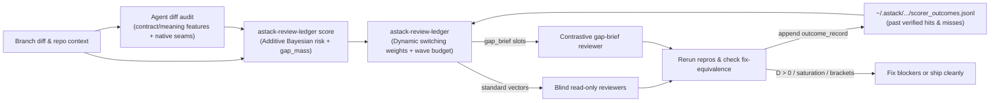

# How astack reviews code

**Status: implemented** across `bin/astack-review-ledger`, `lib/astack_ledger/` (`risk.py`, `capture.py`, `engine.py`, `format.py`), `bin/astack-statechart`, `skills/review/SKILL.md`, `skills/risk-modeling/SKILL.md`, `skills/adversarial-review/SKILL.md`, and `skills/quickcheck/SKILL.md`.

---

## Our review philosophy

Code review fails in two opposite ways: trusting vibes (*"looks good to me"*) or drowning in rigid, context-blind machinery that flags false alarms while real bugs slip through the cracks.

`astack` separates what **agents** are great at from what **tiny deterministic Python** should own:

- **Agents own judgment, context, and domain tools.** Agents read your repo's real docs, ADRs, PR threads, and surrounding environment (`rtfm`, `lookup`, `analyze-environment`). They inspect diffs in your language, spot subtle contract changes, run your repository's real verification harnesses (property tests, concurrency/race tools, fuzzers, TLA+ via `astack-statechart`), and prove every finding on disk.
- **Minimal Python owns only the math and structural gates.** LLMs shouldn't eyeball probabilities, stopping math, or budget accounting in prose. `lib/astack_ledger/` is stdlib-only, codebase-agnostic, and free of arbitrary magic constants: every bound comes from probability theory, online Bayes, or IEEE-754 float precision.
- **Strict role split.** Reviewers never edit production code, because an author checks what it *meant* to build. Reviewers stay strictly read-only, save runnable repros and evidence outside `repo/` (`~/.astack/<project>/`), and hand proven findings to isolated workers to fix and resubmit.
- **Reproduction is proof ("combine, never vote").** One model's reproduced blocker beats three models' "LGTM." Unverified claims are dropped before they waste worker time.
- **Two modes, chosen by the human:**
  1. **Default — Full vectored review (`review` + `risk-modeling`):** scores risk across failure faces, runs repo-native executable checks on stateful seams, dispatches blind independent reviewers, dynamically guards against scorer blind spots, and stops via capture-recapture and residual risk brackets.
  2. **Explicit opt-in — Focused single-reviewer pass (`quickcheck`):** when you explicitly invoke `/astack:quickcheck` (either in your initial prompt to Lead before shipping worker work, or directly on any branch, diff, PR, or code), astack skips vectored review and assigns **one** focused read-only reviewer. Its sole job is catching real blockers against known architectural choices/tradeoffs, known issues, or expected tooling/implementation behaviors—never raising issues you already clarified or that are explained in surrounding docs, code, tooling, or environment. Once proven blockers are fixed, the work commits, pushes, and opens a PR cleanly. Lead never downgrades from `review` to `quickcheck` unprompted.

---

## Key concepts at a glance (plain English first)

Before diving into the formulas, here is what every term means in everyday language and why it exists:

- **Atom:** the smallest unit of change we score—by default, one `(commit, file)` pair in your branch diff (for example, `c5a44896:src/memory.rs`). If a commit touches 5 files, that's 5 atoms. If 7 commits touch `memory.rs`, `memory.rs` has 7 atoms.
- **Vector:** a *way the change could fail*—such as concurrency, persistence, auth, query planning, memory budgets, or cross-module seams. Lead groups related atoms into vectors so reviewers attack concrete failure modes instead of skimming a giant undifferentiated diff.
- **Risk vs. Hazard Mass (`q` vs. `m`):** probabilities don't add cleanly—two independent 50% risks combine to 75%, not 100%, and huge changes pile up near `0.9999` where you can no longer tell which piece is 5× riskier than another. So we convert each atom's predicted fault probability $q \in [0, 1)$ into **additive hazard mass** $m = -\ln(1 - q) \in [0, \infty)$.
  - Think of **mass** as *expected bug weight* (the rate parameter $\lambda$ of a Poisson process): small probabilities satisfy $m \approx q$ (e.g., $q = 0.05 \implies m \approx 0.051$), while masses **add linearly** across atoms and commits without saturating at `1.0`.
  - When we need a `[0, 1)` probability again (for display or stopping gates), we convert total mass right back into risk.
- **Share (`m(V) / m(change)`):** a vector's slice of the total risk mass. Even before a repo's absolute bug rate is calibrated, shares stay **level-invariant**—if every number were scaled up 10×, the shares (and reviewer allocation) wouldn't budge a millimeter.
- **Clustering variance ($\phi$):** real bugs travel in packs inside commits—one rushed commit often breaks three files together. $\phi = 0$ assumes every atom fails independently; larger $\phi > 0$ accounts for commit-level bursts so a 40-file commit doesn't wildly exaggerate whole-change risk.
- **Epistemic variance (`epistemic_var`):** *how unsure the model is* about an atom's prediction because it hasn't seen many similar historical examples. A routine 1-line tweak in a common bucket has tiny variance; a 600-line review-fix rewrite in a historically quiet file has large variance.
- **Gap mass (`gap_mass`):** the extra risk mass hidden inside the model's own uncertainty—literally how much an atom's hazard mass jumps if you step one posterior standard deviation upward from its average prediction ($m(\sigma(\eta + \sqrt{v})) - m(\hat{q})$). High `gap_mass` means *"the model isn't confident this is safe."*
- **Gap atoms (`gap_atoms`):** the ranked list of `(commit, file)` atoms in your diff with the highest `gap_mass`. Instead of hunting blindly, Lead and reviewers can look straight at `gap_atoms` to see the exact commits where the historical scorer is most uncertain or blind.
- **Dynamic gap share (`dynamic_gap_share`):** the fraction of reviewer allocation weight automatically shifted away from the historical scorer toward `gap` and `uniform` exploration. It is **never a hardcoded percentage**—it starts balanced on a brand-new repo, shrinks as real review hits validate the scorer, and surges immediately if real bugs land in low-score areas.
- **Per-reviewer brief modes (`standard`, `gap_brief`, `standard_with_gap_focus`):** brief mode is assigned **per reviewer**, never blindly across an entire vector. On a multi-reviewer gap-lifted vector (2+ models), **one** reviewer gets the dedicated contrastive `gap_brief` (targeting low-score commits that changed meaning—signatures, error variants, ordering/lock edits, test assertions, or review-fix rework) while the remaining reviewer(s) run `standard` sweeps. On a **1-reviewer** gap-lifted vector, that sole reviewer gets `standard_with_gap_focus` so it runs the full normal sweep *plus* gap focus and never drops standard coverage.
- **Catch table & sharp exchangeable bracket:** an honest map of $M(k)$—the chance that $k$ blind reviewers *all* miss a real bug. Because models share blind spots, off-anchor estimates report exact upper/lower mathematical brackets instead of pretending models are independent coin flips.
- **Fix-equivalence & capture-recapture:** two reviewers found the "same bug" only if one minimal fix makes **both** repros pass. Counting how many bugs two or more blind models both caught vs. caught alone lets us estimate how many bugs of similar detectability are still hiding—just like ecologists estimating fish in a lake by tag-and-release.
- **Risk-scaled Wave 1 (`risk_concentration`):** Wave 1 is greedy and never capped at 2. The highest-risk vector anchors the pool scale ($P$ models) and every other vector contributes proportionally to its share relative to the top vector ($C_{\text{risk}} = \sum_V s^{\text{eff}}_V / \max s^{\text{eff}}$), so high-risk vectors immediately get 3–4 models while low-risk vectors don't waste the entire pool.
- **Returned slots, parallel expansion & recharge:** when a vector finishes clean (`action: "stop"`), its slots return (`returned_slots`) to free concurrency. When a vector uncovers verified bugs (`D > 0`), finding bugs *confirms* we need more capacity: Wave 2 expands in parallel in proportion to capture-recapture's `estimated_unfound` (all remaining unused models when overlap is zero) and automatically **recharges** budget for those active unsaturated vectors (`recharged_slots`, bounded by optional `max_budget_minutes`), while clean waves never mint free budget.

---

## 1. Scoring risk without starving features (`risk.py`)

### Vectors and atoms
Lead slices a change into behavioral **vectors**—the real ways the change can fail (concurrency, persistence, auth, query logic, resource budgets, cross-module seams). Each vector owns a set of **atoms**, defaulting to `(commit, file)` pairs from the diff.

A vector's risk lives strictly in `[0, 1)`. Legacy string labels like `"low"` or `"risky"` are rejected at the CLI boundary (exit code `2`).

### What the git baseline measures (and why we stay codebase-agnostic)
Running `astack-review-ledger score --repo <repo> --base <base> --head <head> --json` works out of the box on any git repository in any language, with zero build cost.

It extracts **8 strictly universal git features** per `(commit, file)` atom:
- `lines_changed`, `files_in_commit`, `is_new_file`, `is_fix_commit` (whether the commit message marks a fix/regression/revert—fixes introduce regressions at high rates), `recent_touches` (commits touching the file within the repo's own median fix horizon—catching active rework), `file_prior_faults`, `dir_prior_faults`, and `prior_touches`.
- It traces historical reverts and fix commits back to introducing commits via `git blame`.

To prevent lookahead bias and silent under-counting, four invariants are enforced mechanically:
1. **Strict pre-`base` training & chronological candidate state:** historical training runs strictly on commits up to `base`, and candidate atoms across `base..head` see only their own parent state as commits advance.
2. **Closed horizon:** training drops the most recent `horizon` commits (`order <= max_order - horizon`, where default `horizon` is the repo's median observed fix lag), so recent commits that haven't had time to fail yet aren't mislabeled as bug-free.
3. **Power-of-two bucketing:** finite numeric features (excluding booleans) map to `0` or `±2^floor(log2(|x|))` so continuous counts generalize cleanly across magnitudes.
4. **Multi-commit file indexing:** when a vector names `"files": ["src/memory.rs"]`, **every** commit touching `memory.rs` in `base..head` contributes to the vector's mass—never just the first commit.

### Why an Additive Bayesian Logistic model (not joint contingency tables)
If you combine 8 bucketed features into full Cartesian joint tables, adding a single multi-bucket feature like `lines_changed` multiplies cell count by ~10×. In Bayesian model averaging over joint tables, that cell explosion crushes `lines_changed`, `file_prior_faults`, and `is_fix_commit` down to ~0 weight, leaving only tiny 2-feature tables like `(files_in_commit, is_new_file)`.

Instead, `fit_atom_risk_mixture` runs **prequential Additive Bayesian Logistic Regression** with a unit-information Gaussian prior $\mathcal{N}(0, 1)$ per `(feature, bucket)` indicator, mixed via exact Bayesian Model Averaging against a constant Krichevsky–Trofimov baseline so noisy histories can never underperform a flat rate:

- **Cost scales linearly ($O(\sum_f B_f)$), not exponentially.** Every informative feature (`lines_changed`, `file_prior_faults`, `is_fix_commit`, `recent_touches`, plus any agent-supplied `extra_features`) earns its own additive log-odds contribution, reported transparently in `feature_effects` and per-atom `feature_contributions`.
- **Exact rank-1 Laplace / Assumed-Density Filtering update (Opper & Winther 2000; Minka 2001):**
  For active indicator keys $K$ with current means $w_k$, diagonal precisions $h_k$, linear predictor $\eta = \sum_{k \in K} w_k$, and log-odds epistemic variance $v = \sum_{k \in K} 1/h_k$:
  - Predictive probability uses MacKay's (1992) closed-form probit integral over posterior uncertainty:
    $$\hat{q}_{\text{add}} = \sigma\!\left(\frac{\eta}{\sqrt{1 + \frac{\pi}{8} v}}\right)$$
  - After observing label $y \in \{0, 1\}$ with $p = \sigma(\eta)$, $g = y - p$, and curvature $s = p(1-p)$, each active key updates by exact rank-1 Gaussian conditioning projected onto its marginal diagonal:
    $$w_k \leftarrow w_k + \frac{1/h_k}{1 + s v}\, g, \qquad h_k \leftarrow h_k + \frac{s}{1 + s (v - 1/h_k)}$$
  Zero learning rates, zero iteration caps, and zero picked regularization constants.
- **Exact epistemic `gap_mass` per atom:** every candidate atom reports its posterior log-odds variance `epistemic_var` ($v$) and its 1-SD upper uncertainty spread:
  $$m_{\text{gap}}(a) = \max\!\big(0,\; m(\sigma(\eta + \sqrt{v})) - m(\hat{q})\big)$$
  where $m(q) = -\ln(1 - q)$ is additive hazard mass. Unfamiliar or rarely-seen combinations (like a large review-fix rewrite in a historically quiet file) automatically carry large `gap_mass` and surface at the top of `gap_atoms`.

### Commit-grouped clustering (`phi`)
Bugs cluster inside commits: a single broken commit often breaks several files at once. Each atom $a$ converts to additive hazard mass $m(a) = -\ln(1 - \hat{q}(a))$, summed within each commit $c$ to $m_{V,c}$. Assuming a commit-level Gamma frailty with variance $\phi \ge 0$ (fit via exact unbounded 1D MLE on prequential commit history) yields the Gamma–Poisson survival risk:

$$p(V) = 1 - \prod_{c} (1 + \phi\, m_{V,c})^{-1/\phi} \in [0, 1)$$

Crucially, **whole-change risk groups by commit ID across vectors *before* clustering**:
$$p(\text{change}) = 1 - \prod_{c} \left(1 + \phi \sum_{V} m_{V,c}\right)^{-1/\phi}$$
so a shared commit spanning two vectors clusters once rather than being double-counted as independent draws. Display rounding (`round_risk`) keeps every rounded probability strictly below `1.0`.

### Where agents beat git counts: repo-native features & finders
Git counts can never know when a 5-line edit flipped a deadline check before a capacity check, changed a public signature, modified an error variant, or weakened a test assertion. Rather than hardcoding brittle language regexes in Python, `skills/risk-modeling/SKILL.md` directs the agent to inspect the diff in the repository's own language and pass domain signals per-atom (`"sha:file": {...}`) or per-file via `extra_features`, or pass a repo-native `(introducing_commit, fix_commit)` finder via `--pairs`.

Baseline runs report raw `finder_checks` (`revert_recovery_rate`, `reverts_checked`, `slice_fix_rates`, `max_to_min_ratio`) with `level_status: "unverified"`—meaning git-only scoring authorizes relative **shares** (`m(V) / m(change)`), never unverified absolute probabilities.

---

## 2. Covering the gaps: dynamic learned exploration (`engine.py`)

A pure historical risk scorer has a famous failure mode—the **baseball shift problem**, only worse. Historical data places your fielders where bugs landed before. Because everyone already scrutinizes obviously scary areas, surviving bugs concentrate in the gaps where the scorer rates risk lowest (like a late `"fix review findings"` commit rewriting a quiet mature file).

Reserving a hardcoded share (say, "always spend 20% on low-risk areas") is an arbitrary constant that wastes budget when a scorer is well-calibrated and under-protects when a scorer is blind. Instead, `astack` learns the exploration share **dynamically** from real review outcomes.

### Three competing experts
Across open risky vectors, the allocator tracks up to three normalized share distributions:
1. **`hist` ($s^{\text{hist}}$):** risk-mass shares from the historical scorer.
2. **`gap` ($s^{\text{gap}}$):** epistemic uncertainty / agent-supplied divergence shares (`gap_mass / total_gap_mass`) spotlighting unfamiliar or meaning-changed commits.
3. **`unif` ($s^{\text{unif}} = 1/M$):** uniform coverage across all open risky vectors.

Their effective allocation weight blends all active experts:
$$s^{\text{eff}}(V) = w_{\text{hist}}\, s^{\text{hist}}(V) + w_{\text{gap}}\, s^{\text{gap}}(V) + w_{\text{unif}}\, s^{\text{unif}}(V)$$
Notice every term is a normalized share, so allocation stays **100% level-invariant**: multiplying all risk masses by 10× changes nothing.

### Learning `w` without confirmation bias
After each completed review, Lead appends `outcome_record` (each vector's `hist_share`, `gap_share`, `reviewers_completed` $k_V$, and verified blocker count $D_V$) to `~/.astack/<project>/reviews/scorer_outcomes.jsonl` and passes it back via `--outcomes`.

If you updated expert weights on raw observed bug counts $D_V$, vectors given 4 reviewers would naturally surface more bugs than equally buggy vectors given 1 reviewer—creating a self-reinforcing confirmation-bias spiral! To prevent that, each expert's predicted bug-landing distribution is **conditioned on the actual detection probability** $c(k_V) = 1 - M_{\text{alloc}}(k_V)$ from the catch table:

$$\tilde{p}_e(V \mid k) = \frac{s^{(e)}(V)\, c(k_V)}{\sum_j s^{(e)}(j)\, c(k_j)}, \qquad \ell_{e,t} = \sum_V D_{t,V} \ln \tilde{p}_e(V \mid k)$$

To stay responsive if bugs move to *new* gaps over time, posterior weights update via **parameter-free Decreasing Share** (Herbster & Warmuth 1998; Koolen & de Rooij 2013) with switching rate $\alpha_t = \frac{1}{t + 1}$:

$$w_{e, t+1} = (1 - \alpha_t)\, w'_{e,t} + \frac{\alpha_t}{E}$$

What this produces automatically—with **zero fixed gap constant**:
- **Cold start ($t = 0$, brand-new repo):** starts at uniform prior ($1/E$ per expert). An unvalidated git proxy cannot starve other vectors on day one.
- **When the historical scorer proves accurate:** verified bugs consistently land where `hist` predicted, so $w_{\text{hist}}$ climbs and `dynamic_gap_share` ($w_{\text{gap}} + w_{\text{unif}}$) shrinks smoothly toward zero.
- **When bugs land in low-score gaps:** `hist` takes a steep debiased log-loss penalty, `miscalibrated_on_gaps` flips `true` (purely because `hist` has worse cumulative debiased log-loss than `gap` or `unif`), and `dynamic_gap_share` immediately surges so the next wave shifts reviewers into the gaps.

### Per-reviewer contrastive `gap_brief` assignment & failover transfer (the "infielder")
Whenever the gap and uniform experts lift a vector strictly **above** its historical share ($s^{\text{eff}}(V) > s^{\text{hist}}(V)$, equivalently $s^{\text{non-hist}}(V) > s^{\text{hist}}(V)$), `gap_lifted` flips `true`. Because both shares sum to `1`, it is mathematically impossible for every vector to be gap-lifted. Rather than overriding the whole vector, the ledger assigns `brief_mode` **per reviewer** inside each `next_models[i]` entry (after any hard `max_budget_minutes` trimming):
- **Not gap-lifted (`gap_lifted: false`):** every model runs `standard`.
- **Gap-lifted with 2+ reviewers (`standard_plus_gap_brief`):** **exactly one** non-worker reviewer receives the contrastive `gap_brief` targeting low-score, high-meaning-change commits from `gap_atoms` and the diff audit (signatures, error variants, ordering edits, edited test assertions, or review-fix commits), while the remaining reviewer(s) run full `standard` sweeps. Across multiple gap-lifted vectors, the `gap_brief` slot rotates deterministically across non-worker providers so one vendor's blind spot or content filter cannot knock out every gap brief at once.
- **Gap-lifted with 1 reviewer (`standard_with_gap_focus`):** when a gap-lifted vector receives only a single reviewer in Wave 1 (such as a low-weight vector or a trimmed slot), that sole reviewer gets `standard_with_gap_focus`—running the full standard vector sweep *and* checking the `gap_atoms`, never dropping the normal review. If a second reviewer joins in Wave 2 before any dedicated `gap_brief` has run, that second reviewer takes `gap_brief`.
- **Automatic failover, receipt ingestion & clean capacity tracking when a model blocks or fails:** `astack-dispatch` stamps `--brief-mode`, execution status, and trailing stderr error text (`note`) onto every receipt JSON and automatically writes a receipt copy into `--review-dir` whenever `--review-dir` is passed. Passing `--receipts <review_dir>` (or `receipts_dir` / `dispatch_receipts` in the ledger JSON) lets `astack-review-ledger` ingest failed, timed-out, or content-filtered reviewer receipts automatically so a Lead can never forget to record a failure. Lead can also log failures explicitly in `failed_reviews` (or `reviews` with `status: "blocked" | "failed" | "timed_out" | "unreachable"`, plus `unreachable_models` when globally unavailable) alongside each completed reviewer's `brief_mode`. Any `blocked` / content-filter failure is promoted **globally** into `unreachable_models` so the blocked model is not wasted on other vectors either. Contradictory payloads claiming the same model both completed and failed on one vector fail fast with a validation error (exit `2`), while superseded older receipts from a successful retry are cleanly ignored. Active failures return their concurrency slots immediately (`failed_slots_returned`, `returned_slots`), cap per-vector demand to remaining non-failed models so no phantom slots are burned, log in `could_not_test`, and automatically transfer (`gap_brief_transfer_after_model_failure` / `transfer_after_model_failure`) to another reachable approved model in `reviewer_pool` (recharging only unresolved transfers, strictly bounded by hard `max_budget_minutes`—reporting `capped_by_max_budget` whenever the cap prevents recharging a slot). If no other reachable approved model remains, the ledger flags `gap_brief_unrun_pool_exhausted` with `landing_blocked: true` instead of silently dropping coverage or mislabeling it `budget_exhausted`.

---

## 3. Catch tables, sharp brackets, and wave budgets

### Honest catch tables (`prior`, `anchored`, `measured`)
How much risk remains after $k$ blind reviewers find zero bugs depends on the panel miss probability $M(k)$—the chance that all $k$ models miss a real bug. Because different LLMs share blind spots, bugs are **not** independent coin flips across models; assuming geometric decay $M(k) = m_0^{k/k_0}$ is dangerously optimistic.

`build_catch_table` supports three explicit provenance tiers:
- **`measured`:** directly observed miss rates $M(k)$ across panel sizes from repo-local replay.
- **`anchored`:** measured at one panel size $(k_0, m_0)$ (for example, replaying known repo bugs at $k_0 = 2$). At $k = k_0$, the point estimate is $m_0$. At **every other $k$**, `residual_risk` is `null` and `residual_risk_bracket` reports the **exact sharp exchangeable bounds**:
  - For $0 < k < k_0$: $[m_0,\; m_0^{k/k_0}]$
  - For $k > k_0$: $[m_0^{k/k_0},\; m_0]$
  For internal reviewer-slot allocation ordering only, `catch_miss_at` uses the unique interior unit-information Beta–Binomial exchangeable curve ($a + b = 1$ solving $M_{\text{BB}}(k_0) = m_0$), strictly inside the sharp bracket with diminishing returns.
- **`prior`:** unmeasured catch table with honest `[0, 1]` residual risk bounds and Jeffreys $\text{Beta}(0.5, 0.5)$ for internal slot ordering.

When anchored reading miss sits high (e.g. near `0.80`), adding more reading waves hits steep diminishing returns—that's the signal to spend budget on **repo-native executable checks** (property tests, concurrency/loom/race tests, fuzzers, or TLA+ via `astack-statechart`). Verified native seams (`seams`) let a positive-risk vector close cleanly after one non-worker review.

### Greedy risk-scaled Wave 1 and evidence-driven recharge
Wave 1 is **never capped at 2 reviewers** — it is a direct, greedy reflection of risk:
- **Risk-scaled Wave-1 demand (zero arbitrary constants):** Let $r_V = s^{\text{eff}}(V) / \max_j s^{\text{eff}}(j) \in (0, 1]$ measure each vector's risk relative to the highest-risk vector, and let $C_{\text{risk}} = \sum_{V=1}^{M} r_V \in [1, M]$ be the change's effective risk concentration. Wave 1's risk-proportional slot demand is:
  $$S_{\text{wave1}} = \max\!\Big(M,\; \min\!\big(M \cdot P,\; \lceil P \cdot C_{\text{risk}} \rceil\big)\Big)$$
  The top-risk vector anchors the pool scale ($P$ models) while lower-risk vectors contribute proportionally. Wave 1 allocates up to $\min(B,\; W_{\text{cap}},\; S_{\text{wave1}})$ slots **purely greedily** by $s^{\text{eff}}(V) \cdot [M_{\text{alloc}}(k) - M_{\text{alloc}}(k+1)] / \text{cost}$ (100% level-invariant). Optional `budget.wave_budget_minutes` and `budget.max_wave_reviewers` act strictly as ceilings — they never override risk scaling upward. When `residual_target` is set, each vector stops taking slots the moment its expected residual risk meets target.
- **Post-wave returned capacity, parallel secondary expansion, and evidence-driven recharge:** After Wave 1 finishes, real findings reshape capacity automatically:
  1. **Completed clean vectors return capacity:** any vector that closes (`action: "stop"`) leaves the active wave immediately (`returned_slots`), returning its concurrent slots to vectors that still need work.
  2. **Parallel capture-recapture expansion on `D > 0`:** when models agree unanimously on a small count (`zero_singletons`), Wave 2 dispatches `1` confirming model. When models are still uncovering **disjoint singletons** (`models_still_finding_new_bugs`), Wave 2 expands in parallel—dispatching all remaining unused models when overlap is zero (`informative: false` or unbounded CI), or `min(unused, ceil(estimated_unfound))` when overlap bounds the estimate.
  3. **Lead- and seam-proven blockers count too:** passing `known_blockers` (bugs already proved by Lead's tests/repros) or linking a failed native `seam` prevents clean stops, triggers inline gap-weight refresh immediately, and unlocks recharge without contaminating independent capture-recapture model counts.
  4. **Evidence-driven recharge & hard `max_budget_minutes` cap:** clean waves (`D = 0`) never mint free budget. Active unsaturated vectors with reviewer-, lead-, or seam-proven blockers automatically **recharge** the exact shortfall slots needed (`recharged_slots`, `effective_budget_minutes`, `**BUDGET RECHARGED**`). If an explicit hard `budget.max_budget_minutes` ceiling is set, excess dispatches are trimmed by urgency right out of `next_models` and `next_actions` (`trimmed_by_max_budget_slots`, `could_not_test`, `**MAX BUDGET CAP REACHED**`) so Lead never spends past the hard cap.
- **Honest overruns:** if the mandatory 1-per-vector minimum exceeds effective remaining budget, the ledger sets `budget_exceeded: true`, reports exact `budget_overrun`, and prints `**BUDGET OVERRUN**`.

---

## 4. Stopping when bugs are found (`capture.py`)

Only **verified, fix-equivalent `P0–P2` blockers** count in stopping math (`P3–P5` suggestions and nits are reported cleanly to workers and users without triggering extra review rounds). Two findings count as the same bug only when one minimal fix makes **both** standalone repros pass (`fix_verified: true`), never by similar wording.

When $D > 0$ blockers are found on a vector:
- **At $k = 2$ independent models:** Chapman's estimator plus the **exact hypergeometric tail probability** `p_at_least_one_unfound` (the exact chance that at least one bug of similar detectability was missed by both models, even when both found the exact same 1 bug—which distinguishes `unanimous_small_count_needs_capture_recapture_check` from `models_still_finding_new_bugs`).
- **At $k \ge 3$ independent models:** Burnham–Overton Jackknife $M_h$ plus continuous Beta–Binomial $M_h$ bounds.
- **No hardcoded 95% cutoff:** by default, `confidence_alpha` is `null` (no baked-in `Z_95` magic constant), reporting exact probabilities directly. If a caller explicitly requests a significance level `confidence_alpha`, quantiles are derived on demand from `statistics.NormalDist().inv_cdf(...)`.

---

## 5. Structural gates and clean reporting

Finally, `astack-review-ledger` enforces non-negotiable structural safety gates:
- **Non-worker independence:** a vector reviewed only by the worker's own model flags `worker_model_only` and demands a non-worker reviewer.
- **Approved pool only:** any model outside `reviewer_pool` exits with code `2`; unreachable approved models are logged in `could_not_test` and set `landing_blocked: true` instead of silently substituting another vendor.
- **No duplicate models** on the same vector, and **`astack-check-gates`** catches deleted tests, skips, lint mutes, or loosened tolerances across the git range.
- **Zero internal leaks:** coverage maps, `LANES.md` entries, `scorer_outcomes.jsonl`, model rosters, expert weights, and `[rule: ...]` tags stay strictly internal. Humans get plain English (`wat`): proven `P0–P2` blockers with repros and fixes, `P3–P5` suggestions, what held, and anything that could not be checked.
